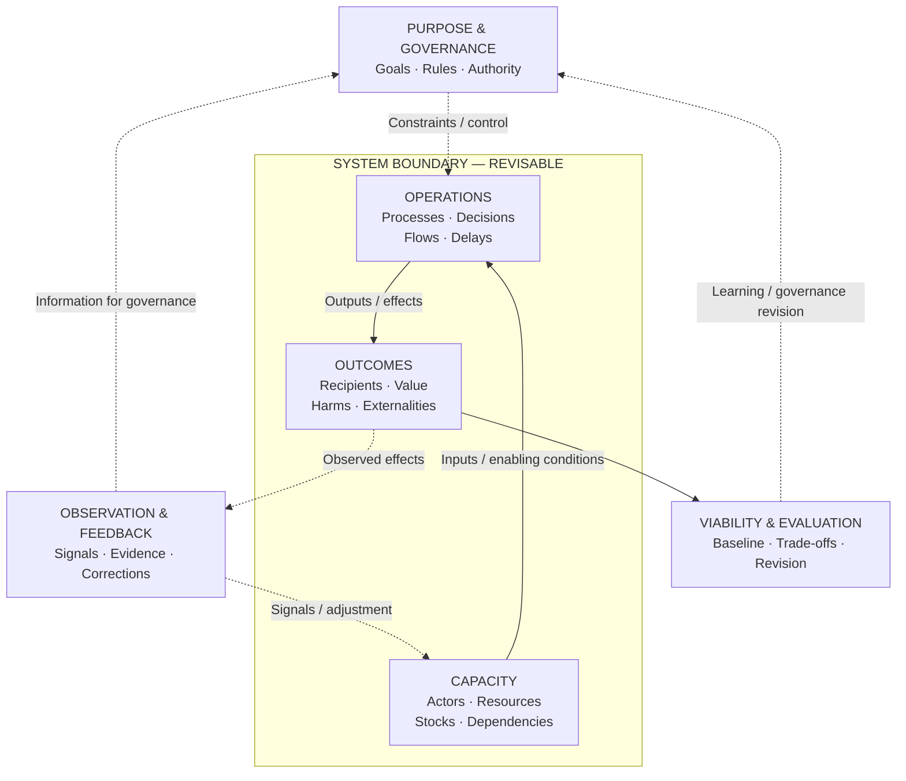

# System Canvas — Core Thesis and Design

**Provisional practitioner-method thesis · v0.3**

## Canonical visual grammar — spatial relations before notation

The **overview canvas** should communicate system dynamics implicitly, as the Business Model Canvas does for business models. It is **not** a universal causal graph or a replacement for VSM, IAD, 4EM, ArchiMate or formal models. Spatial positions are stable across views.

**Interpretation:** left to right indicates enabling inputs, transformations and effects; above indicates purposes, rules and control; below indicates evaluation, accumulated consequences and redesign; the returning path indicates observations and feedback. This is an *orientation* for inquiry, not a claim that the arrows exist or have known causal strengths in every case.

### Visual constructs and relationships

| Construct | Visible placement | Underlying relationships to investigate |
|---|---|---|
| **Capacity** | Left | Resources, participants, capabilities, dependency networks, buffers, stock accumulation/depletion |
| **Operations** | Center | Activities, transformations, state changes, flows, rates, throughput and latency |
| **Outcomes** | Right | Produced outputs, recipients, value, harms, displaced costs and environmental changes |
| **Purpose & governance** | Above | Goals, operational targets, decision rights, constraints, incentives, enforcement, appeals |
| **Observation & feedback** | Return path | Information provenance, sensing, delays, errors, reinforcing/balancing loops and corrective action |
| **Viability & evaluation** | Below | Sustained operation, affected-party impacts, normative criteria, counterfactuals, intervention tests and revision |

The same actor or resource can participate in multiple regions. Regions are **functions or analytical roles, not departments, exclusive partitions, or physical locations**. The boundary can expand to include regulators, supply chains, ecological systems or other strategic interactions.

### Projections, not six disconnected diagrams

The Structural, Behavioral, Epistemic, Deontic, Teleological and Evaluative **lenses are selectable emphasis on this same model**. They may reveal more detail: a dependency map, stock-flow model, causal loop, evidence provenance map, action situation/authority matrix, goal-conflict view or evaluation design. Preserve identities and record which connections are established, contested, hypothesized or unknown. A simple view should never imply a fully specified dynamic model.

### Leverage points and revision

A contextual intervention layer uses Meadows-inspired kinds of leverage: **stocks and buffers → flows/delays → feedback → information access → rules and authority → goals and paradigms**. These are *categories*, not one universally ranked list or guaranteed causal levers. A practitioner first locates the affected region, then asks what can actually be changed, by whom, with what observations and adverse effects.

**Formal backplane (optional):** algebraic composition can clarify operations; coalgebraic perspectives can describe state-dependent behavior; categorical structures support interfaces/composition; control theory models dynamics and regulation; open games model selected strategic interactions; institutional analysis and epistemic/deontic frameworks clarify rules, information and authority. None of these mappings is automatic, and none substitutes for empirical validity.

## Reframed contribution: a practitioner interface to systems research

**Primary proposal:** an accessible, problem-led procedure for **analysis, diagnosis, evaluation and refinement** of real human organizations and institutions. This is a methodological and interaction-design hypothesis, not a claim to have invented new systems laws.

The practitioner should not need to master VSM, IAD or open-game semantics before asking useful questions. The framework should instead reveal the theory **when the problem requires it**. Its principal design constraints are:

1. **Problem first:** start with a concrete undesirable outcome and its affected parties, not a universal ontology.
2. **Progressive disclosure:** a one-page overview first; expand into the necessary analytical lens, boundary or causal detail.
3. **Traceability:** keep a route from each plain-language question to established theory, evidence, assumptions and alternative explanations.
4. **Comprehensible but not misleading:** hide *unnecessary user-facing complexity*, not mechanisms, uncertainty or disagreement essential to a valid diagnosis.
5. **Reflexivity:** include the analyst and regulator within the inquiry when their observations, incentives, metrics or authority change the system.
6. **Revision over completeness:** treat the model as a temporary instrument for action, not a complete specification of an open, dynamic system.

### Four capabilities, five optional procedural moves

The four capabilities organize what users need: **analyze → diagnose → evaluate → refine**. These overlap and iterate; they are not a compulsory linear waterfall. The existing **Frame → Map → Explain → Redesign → Test/adapt** sequence is one lightweight *usage procedure*: frame/map support analysis, explain supports diagnosis, evaluation is continuous, and redesign/testing support refinement.

The six lenses are **optional drill-downs**, not six panels every practitioner must fill. A map might be adequate with Structure and Authority alone; a claim-dispute case might require Knowledge and Authority; a viability question may warrant Behavior and Outcomes.

### Relationship to prior art

| Framework | Reuse rather than replace | Candidate usability contribution |
|---|---|---|
| **Ostrom IAD** | Action situations, rules, actor positions, information and nested institutional choices | Translate institutional prompts into accessible, case-led worksheets; connect rule changes to downstream mechanisms |
| **Beer VSM / Espejo ECM** | Organizational viability, coordination, recursive regulation, observer-aware organizational diagnosis | Offer simple entry views and progressive zoom rather than requiring initial fluency in full cybernetic diagrams |
| **4EM/EKD** | Goals, actors, processes, business rules, participatory enterprise modeling | Provide a sharper question-to-diagnosis-to-intervention workflow, not merely more diagram types |
| **ArchiMate** | Consistent enterprise-architecture viewpoints and traceability | Link formal views to explanatory mechanisms, evidence and decisions |
| **C4 / Business Model Canvas** | Audience-oriented abstraction levels and workshop-friendly orientation | Transfer visualization and facilitation patterns into sociotechnical analysis, without assuming those tools solve causal diagnosis |
| **Second-order cybernetics / compositional open games** | Reflexive observation, nested governance and formal strategic interfaces | Use as *optional analytical escalations* for problems where observers or interacting incentive structures are causally relevant |

**Non-novelty warning:** Espejo and others have already explored second-order organizational cybernetics; IAD models rule-changing levels, and 4EM already provides an accessible participatory process. Claims of innovation must therefore be tested **against these actual methods**, not against caricatures of their diagrams.

### Abstraction and situated complexity

Category theory offers a formal language of relationships and composition; it is **not itself a substitute for empirical explanation**. Biology and ecology provide concrete, complex examples of homeostasis, adaptation, interdependence and self-production. Organizational application requires specifying which features transfer and which remain analogy. An organization can regulate a variable (homeostasis) without being autopoietic; it can produce external outputs (allopoiesis) while also maintaining organizational structures. Do not label an institution biologically autopoietic merely because it persists.

Human systems are open, temporal and partly unknown: participants reinterpret rules, respond strategically, contest goals and may adapt to the act of measurement. The correct model is a **selective, revisable representation**, not a complete one.

### Evidence of success

The design succeeds only if people can **apply** it, not merely admire or understand the visuals. Compare novice and expert users on correct mechanism identification, unsupported claims, appropriate intervention design, learning/transfer, time, workload, and communication clarity. A prettier diagram with worse causal judgments is a failure.

## Thesis

Persistent outcomes in organizations and other open systems are often reproduced by interacting structures, incentives, information asymmetries, rules, goals and feedback. System Canvas proposes that a **multi-perspective, reflexive, intervention-oriented diagnostic procedure** can improve practitioners' ability to explain those outcomes and propose accountable, testable redesigns. This proposition is unvalidated.

The objective is **understanding sufficient for intervention**, not exhaustive formal description.

## The six views

| View | What to examine | Intervention possibilities |
|---|---|---|
| Structural | Actors, boundaries, dependencies, resources and decision power | Redistribute authority, resources, or pathways |
| Behavioral | Actions, incentives, strategic interactions, state changes and feedback | Change processes, incentives or feedback |
| Epistemic | Observations, claims, knowledge, beliefs, uncertainty, credibility | Verification, access, transparency and correction |
| Deontic | Permissions, obligations, prohibitions, authority, enforcement | Rule revision, accountability and appeals |
| Teleological | Declared purposes, operational objectives, stakeholder conflicts | Revise goals, negotiate tradeoffs and constraints |
| Evaluative | Effects, externalities, distribution, evidence and legitimacy | Measures, safeguards and iterative review |

**Cross-cutting:** time, causal inference, power, environmental boundaries, overlapping strategic games, and recursive regulation. Use specialized visualizations as required, rather than mandating every panel.

## Visual models

- **System Canvas:** one-page orientation to purpose, actors, outcomes, mechanisms and intervention.
- **Boundary / dependency map:** systems, participants, containment versus participation, resources crossing interfaces.
- **Process / causal-loop view:** repeated actions, feedback and time delays; label uncertain causal arrows.
- **Knowledge / evidence map:** source → claim → verification → beliefs; distinguish truth from perceived credibility.
- **Authority / rule view:** decision rights, obligations, enforcement, appeals and rule revision.
- **Goal / tension map:** stated purpose versus rewarded behavior versus observed function.
- **Outcome / intervention map:** baseline, intended change, indicators, side effects and regulator accountability.

The same actor must remain recognizable across views; diagrams are projections of a shared inquiry, not independent factual truths.

## Method: five moves

1. **Frame:** name a persistent outcome, affected parties, system boundary and available evidence.
2. **Map:** select lenses relevant to the causal question.
3. **Explain:** state a reproducing mechanism and rival explanations; separate evidence from hypotheses.
4. **Redesign:** change an identifiable lever with an accountable actor, explicit tradeoffs and a causal rationale.
5. **Test and adapt:** define measures, adverse effects, falsification criteria and revision authority.

### Second-order reflexivity

Analyze the regulators and observers themselves: who chooses the metrics, who can see failures, whose incentives shape enforcement, and who may challenge rule-makers? Expand the model boundary when upstream governance changes the intervention possibilities. Recursion is a practical diagnostic technique, not by itself formal second-order cybernetics.

### Boundary-aware games

A chess match can be studied as a bounded interaction, while tournaments, rankings and careers create overlapping incentives. An actor can **belong to** an organization and **participate in** multiple games. Not every flow is a game; strategic interdependence must be demonstrated.

### Congruence and legitimacy

Distinguish **declared purpose**, **operational objective**, **observed outcome** and **normatively desirable outcome**. Goal congruence alone does not establish legitimacy. Stakeholders may have irreconcilable interests; redesign can require negotiated authority or material redistribution.

## Boundaries of the claim

A feedback diagram is not a causal proof. A norm is not necessarily enforced. Credibility is not truth. Authority is not legitimacy. Power is relational capability, not generally a conserved zero-sum quantity. Viability is not automatically ethical desirability. The separate Human Viable Systems Model can supply specific normative evaluation criteria.

## Contribution to assess

The claim of novelty is **usable integration**, not invention of systems theory, game theory, deontic logic or causal analysis. Compare against Beer's VSM, Ostrom's IAD, 4EM/EKD, causal-loop analysis and ordinary stakeholder mapping.

See [field guide](system-canvas-field-guide.md), [course](system-canvas-course.md), and [research thesis](../research/system-canvas-research-thesis.md).
