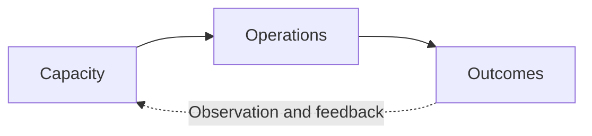

# System Canvas — Learn by Redesigning Systems

**Six-module course · theory-optional · v0.3**

## Visual lesson: implicit cybernetics in one canvas

The same spatial arrangement should remain recognizable from a beginner's overview to an expert's dynamic model. Start with left-to-right **capacity → operations → outcomes**. Introduce **governance above**, **viability and evaluation below**, and **feedback looping back** only when the learner asks what directs, sustains or corrects the system.

**Progressive exercise:** (1) identify inputs/outputs without jargon; (2) mark where resources accumulate and flow; (3) distinguish measurement from control; (4) add rules, goals and legitimacy; (5) find a Meadows-inspired leverage category and name the evidence needed to test an intervention. Preserve the same entities across each view. This is a teaching progression, not a statement that all systems work in the same way.

Compare with the Business Model Canvas's implicit value architecture and with C4's audience-based levels, while using IAD, VSM/ECM and 4EM as substantive models where their distinctions matter.

## Learning design: progressively disclose complexity

The **default learner path is practical**: recognize a problem → sketch the smallest useful boundary → propose a reproducing mechanism → check who benefits, decides and bears costs → choose what to change → gather evidence and revise. The four practitioner capabilities are **analysis, diagnosis, evaluation and refinement**. The six lenses and five moves are *scaffolds*, not material students must memorize before doing an exercise.

| Layer | What the learner sees | When to disclose more |
|---|---|---|
| **Orientation** | One question, one simple picture, one decision | A stakeholder cannot understand the boundary or result |
| **Working diagnosis** | Relevant actors, mechanism, competing explanation and evidence tags | The causal explanation remains ambiguous |
| **Focused analytical view** | One or two of the six lenses | Rules, information, power or feedback matter to the mechanism |
| **Theoretical depth** | IAD, VSM/ECM, 4EM, causal inference, second-order cybernetics or open games | A student needs greater precision, comparative critique or predictive structure |

**Visual grammar:** C4-style zoom and stable actor identity; Business Model Canvas-style workshop orientation; 4EM/ArchiMate-style linked viewpoints. Do not transplant jargon or the full diagrams as prerequisites.

### Teaching an honest simplification

A one-page diagram must support a real judgment, not erase uncertainty. Each worked example should include: (1) the smallest adequate diagram, (2) a case where it produces a wrong or incomplete inference, (3) the single additional view that fixes the problem, and (4) the evidence required to assess that inference.

**Before optional theory**, learners should be able to answer: *Which relationships are observed? Which mechanisms are hypothetical? Who could act? What would change your mind?*

### Expanded learning assessment

Retain the existing rubric and independently measure **time-to-competence**, correctness on an unseen case, diagram comprehension versus diagnostic performance, ability to select only relevant views, unnecessary modeling effort, cognitive workload, and error patterns. Compare with realistic instruction in IAD, VSM, 4EM or a standard organizational workshop—not only unaided learners.

## Learning outcome

Independently frame a bounded problem, identify a defensible reproducing mechanism, compare interventions, and propose evidence-based evaluation. No prior mathematical systems theory required.

**Teaching pattern:** worked example → guided exercise → independent transfer. Every module produces a visual artifact; optional theory is never a prerequisite.

| Module | Case and core skill | Artifact | Optional theory |
|---|---|---|---|
| 1. Boundaries | Chess match → tournament → rankings → career | Boundary/interface map | General systems theory; compositional games |
| 2. Feedback | Journalistic content and platform distribution | Causal hypothesis loop with evidence tags | Cybernetics; causal inference |
| 3. Knowing and deciding | Contested newsroom claim: evidence, editors, audience | Evidence chain and authority matrix | Epistemic and deontic logic; IAD |
| 4. Competing games | Dating apps: users, platform and matching incentives | Goal-conflict and strategic-interaction sketch | Game theory; information economics |
| 5. Recursive governance | Workers perform operations while others set rules | Power / decision-rights map and redesign | Second-order cybernetics; VSM |
| 6. Intervention | Revisit journalism with a proposed redesign | Intervention and evaluation plan | Program evaluation; Goodhart effects |

Plan approximately 60–90 minutes per module, adjusted after pilots.

## Module exercises

### 1 — Chess: what changes when the boundary changes?

Map a match, the tournament that scores it, and a wider ratings ecosystem. Trace points, reputation, invitations or money across boundaries. Distinguish containment from participation. **Check:** Can someone else identify the interfaces?

### 2 — Journalism: explain a recurring outcome

Draw a *hypothetical* loop: engagement ranking → visibility rewards → publisher adaptation → content patterns → engagement data. Mark links **observed**, **source-supported**, **hypothesized**, or **unknown**. Provide a competing explanation. **Check:** What evidence could falsify your loop?

### 3 — Newsroom: knowledge versus authority

Trace source → assertion → verification → publication → audience belief. Identify who can approve, correct, appeal or enforce standards. **Check:** Have you separated popularity and credibility from accuracy?

### 4 — Dating app: conflicting goals

Compare participant goals and platform operational targets without assuming actual proprietary ranking behavior. Which information is asymmetric? Which agents can alter rules? **Check:** Are claims about actual algorithms sourced?

### 5 — Organizational governance: who regulates?

Identify agents doing the work, stakeholders allocating authority, and people bearing costs. Compare performance metrics, appeals, and participatory governance; ask who regulates the regulator. **Check:** Are legitimacy and resource distribution considered?

### 6 — Redesign: make a falsifiable proposal

Choose one intervention from the journalism scenario. Record the actor empowered to implement it, expected causal mechanism, baseline, outcome measures, possible harms, stopping criteria and alternatives. **Check:** Could an independent evaluator identify a negative result?

## Capstone

Choose a real bounded issue such as maintenance reporting, school feedback, workplace decisions or content ranking. Complete the [worksheet](system-canvas-field-guide.md). Present: (a) actors and boundary; (b) evidence-based mechanism and rival hypotheses; (c) two redesigns and tradeoffs; (d) test and safeguards; (e) second-order regulator critique.

**Rubric (0–3 each):** boundary clarity; evidence discipline; mechanism justification; attention to goals and authority; intervention fit; evaluation and side effects. Maximum 18, to be revised with teaching pilots.

## Collecting course evidence

With consent: save anonymized artifacts, time-to-completion, confusion points, unsupported claims, rubric scores and independent transfer performance. Satisfaction alone is not validation. Compare with a credible conventional workshop or baseline method when feasible.

See [validation protocol](../research/system-canvas-validation-protocol.md).
