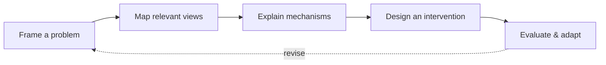

## How it works

## Six analytical lenses

| View | Central question |
|---|---|
| Structural | Who and what is connected, dependent, or in control? |
| Behavioral | What actions and feedback reproduce outcomes? |
| Epistemic | Who knows, observes, verifies, or contests what? |
| Deontic | Who may, must, or can decide and enforce? |
| Teleological | Whose purposes and objectives are pursued? |
| Evaluative | What outcomes arise, for whom, and with what evidence? |

**Research status:** System Canvas is a proposed synthesis, not an empirically validated method. [Read the research plan](/research/system-canvas-validation-protocol).
